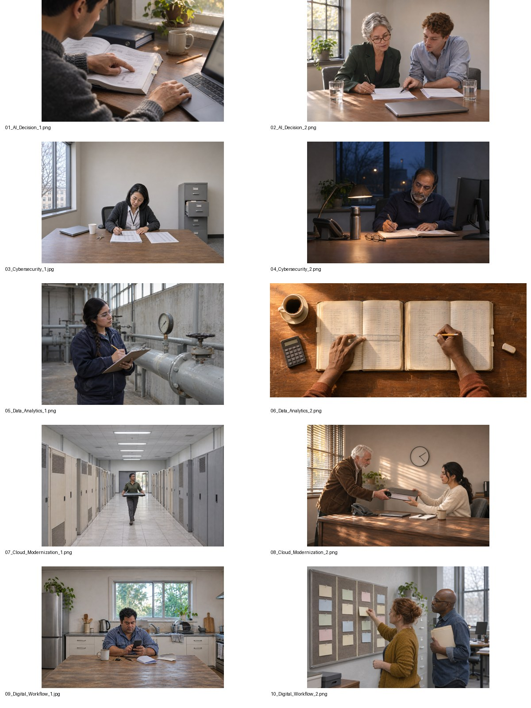
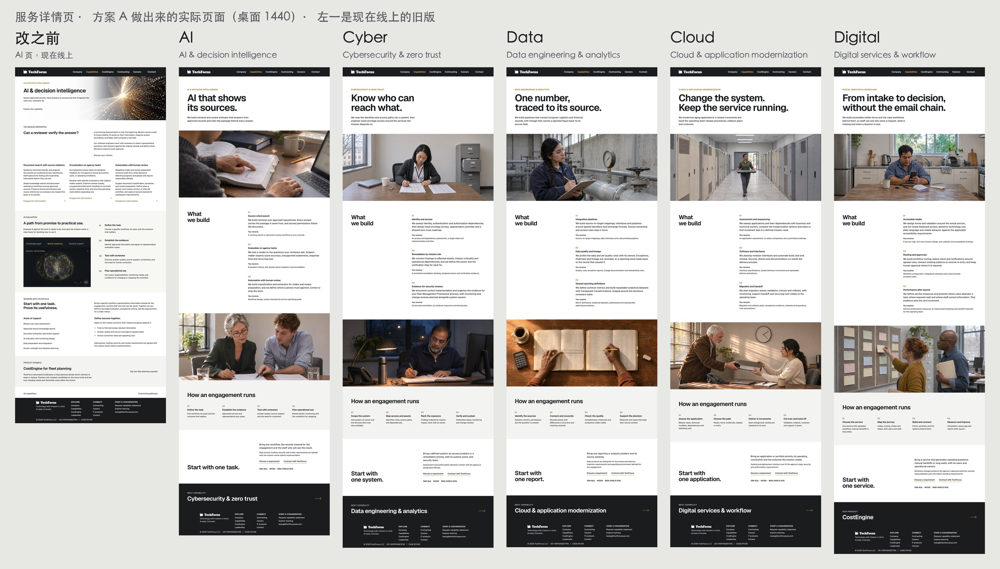

# Claude × TechFocus: Ten Misaligned Website Images

**A public, evidence-based design critique.** These ten images appeared in a saved comparison of five TechFocus federal technology contractor capability pages developed with Claude. The comparison screenshot is included so visitors can see the imagery in page context. The higher-resolution files were recovered from the site-work image collection.

## The pattern, not a one-off

| Capability | Image 1 | Image 2 |
| --- | --- | --- |
| AI & Decision Intelligence | [Paper documents](01_AI_Decision_1.png) | [Paperwork meeting](02_AI_Decision_2.png) |
| Cybersecurity & Zero Trust | [Filling out forms](03_Cybersecurity_1.jpg) | [Writing in a notebook](04_Cybersecurity_2.png) |
| Data Engineering & Analytics | [Industrial clipboard](05_Data_Analytics_1.png) | [Handwritten ledgers and calculator](06_Data_Analytics_2.png) |
| Cloud & Application Modernization | [Walking between cabinets](07_Cloud_Modernization_1.png) | [Handing over paper folders](08_Cloud_Modernization_2.png) |
| Digital Services & Workflow | [Kitchen and dish towel](09_Digital_Workflow_1.jpg) | [Sticky-note board](10_Digital_Workflow_2.png) |

## Why this matters

TechFocus serves U.S. federal technology customers in AI, data engineering, cybersecurity, cloud modernization, and IT. Across **five pages and ten images**, the chosen visual language repeatedly emphasizes paperwork, handwritten records, file transfers, and household scenes rather than the described technical services. The kitchen dish towel and handwritten ledgers are especially incongruous. This is not a criticism of the people or jobs pictured; it is a criticism of **image selection, business relevance, and quality review**.

The images and comparison document the visible result. They do not establish any deliberate intent by Claude or the people behind it.

Archive assembled November 2026. The original private archive remains separate.
